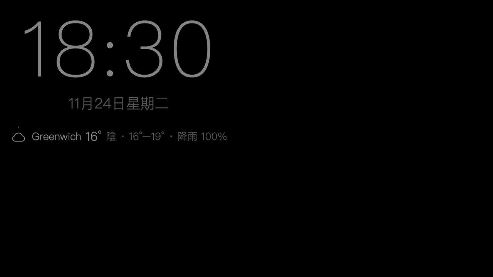
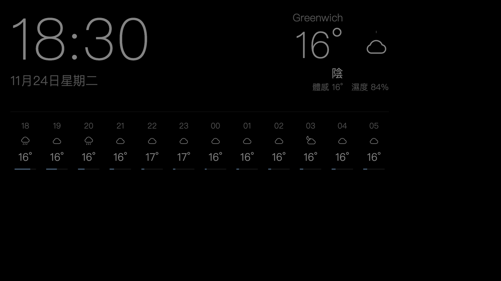
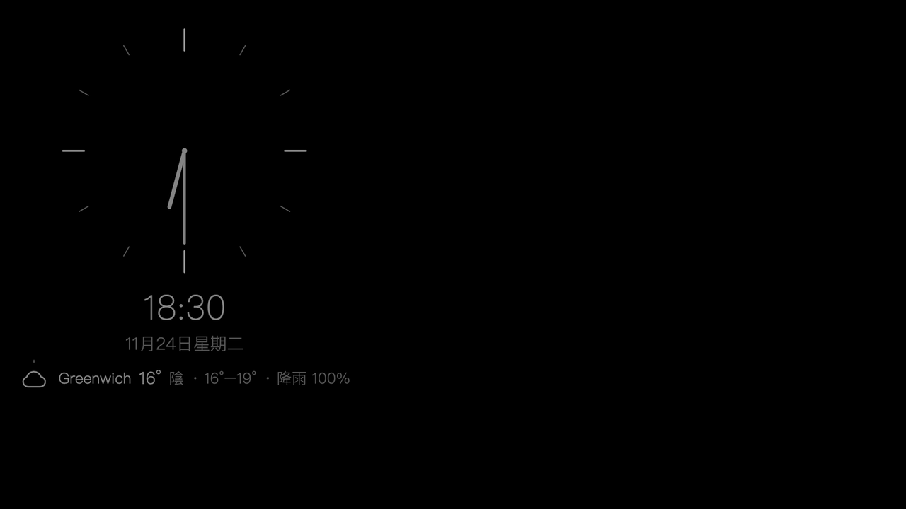
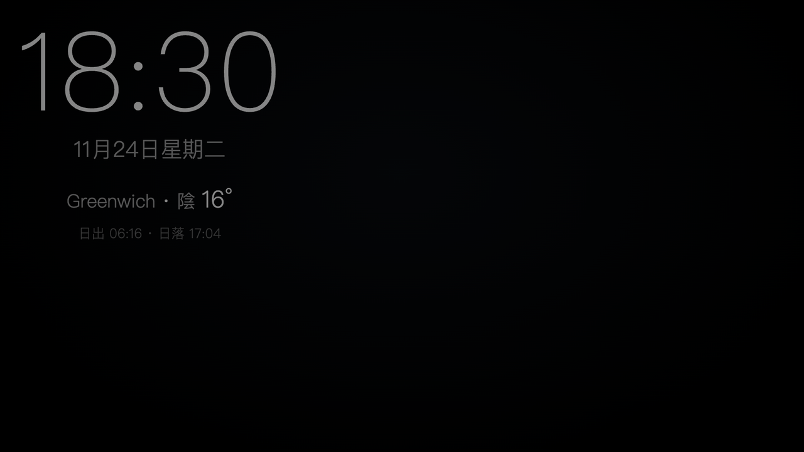
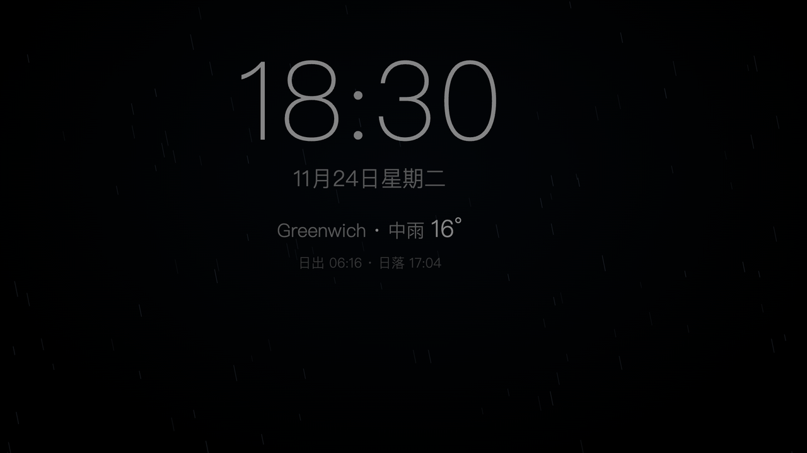
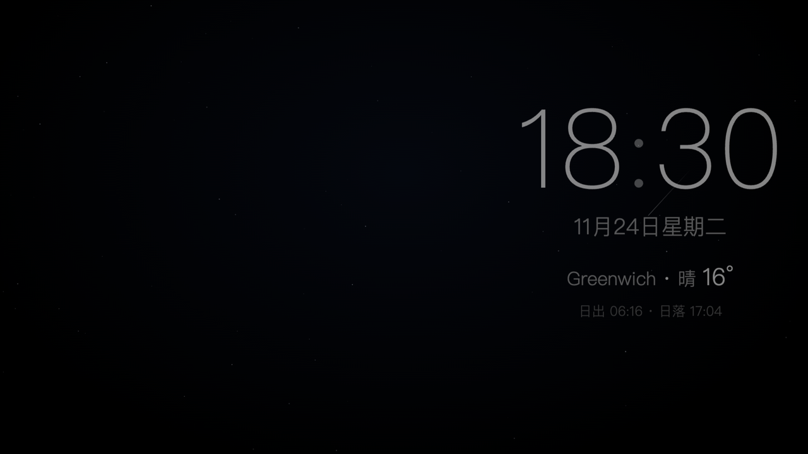
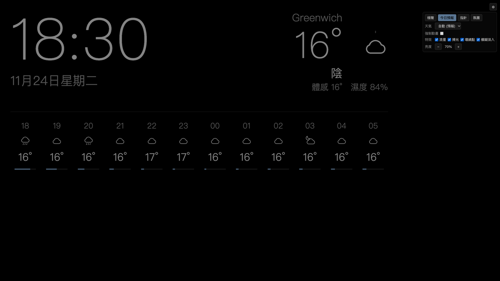

# webos-ambient

A packaged webOS web app for an LG OLED TV (built for a C6, 1920x1080): a clock and the local weather, on screen all day. Black background, no seconds, and the whole layout drifts slowly and continuously and, every few minutes, fades out and reappears in another region of the screen, to protect the panel from burn-in.

The forecast comes from [Open-Meteo](https://open-meteo.com/) (no API key). Place, coordinates and time zone come from your own `config.local.json` (see Configuration below); the refresh interval is in `src/config.ts`. All of it is bundled at build time, and so are the burn-in settings: `floatSpeedPxPerS` (default 3 px/s along x, y moves at 0.73 of that), `floatMarginPx` (default 40, the border the content keeps from the screen edge) and the zone relocation. The screen's free area is a 3x3 grid dealt like a shuffled deck, so every region is visited once per nine relocations and never the same one twice in a row. `relocateMinutes` (default 3) is the interval, `relocateOffsetSec` (default 30) the second past the minute it happens at (so it never lands on the :00 digit roll) and `relocateFadeMs` (default 1200) the length of the fade out and of the fade back in. Between relocations the block drifts about 60 px around its spot, so it is never still. With the system "reduce motion" setting it still relocates, but without the fade.

## Screenshots

Captured headless at 1920x1080 and downscaled to 1280x720, from the bundled forecast fixture with the example place (see Freeze below). Nothing is brightened.

<table>
  <tr>
    <td align="center"><br>Minimal</td>
    <td align="center"><br>Today's forecast</td>
  </tr>
  <tr>
    <td align="center"><br>Analog</td>
    <td align="center"><br>Ambient</td>
  </tr>
</table>

Effects (not frozen, so the particles and meteors move; the layout floats to a different spot on the screen, as it does all day):



Rain streaks behind the clock in the Ambient theme (`?fx=rain`).



A clear night: faint stars and a shooting star crossing the clock (`?fx=clear-night`).



The dev panel on localhost: theme buttons, a weather override, force motion, the four fancy-effect toggles and brightness.

## Configuration

Where the TV is (place name, coordinates, time zone) is personal, so it is never in the source. It lives in `config.local.json`, which is gitignored.

1. `bun run setup` asks for each value (Enter keeps the one in brackets) and writes `config.local.json`. Or script it: `bun run setup --place Greenwich --lat 51.48 --lon 0.01 --tz Europe/London` (flags: `--place`, `--lat`, `--lon`, `--tz`, `--ha-base-url`; keys you leave out keep their current value). You can also `cp config.example.json config.local.json` and edit it.
2. `bun run build` inlines it into `app/main.js` (`scripts/build-js.ts` defines `__USER_CONFIG__`; `src/config.ts` reads it). The packaged app never reads a file at runtime. Without `config.local.json` the build warns and uses `config.example.json`; a config that fails validation (latitude outside -90..90, longitude outside -180..180, empty place, unknown IANA time zone) fails the build and names the bad keys.

| Key         | Meaning                                                               |
| ----------- | --------------------------------------------------------------------- |
| `place`     | Name shown beside the weather                                         |
| `latitude`  | -90 to 90                                                             |
| `longitude` | -180 to 180                                                           |
| `timeZone`  | IANA zone, e.g. `Europe/London`                                       |
| `haBaseUrl` | Optional, empty by default; reserved for a future Home Assistant link |

Gitignored and so never published: `config.local.json`, and the build output `app/main.js` (which contains your values) and `app/style.css`. Committed: `config.example.json` (neutral placeholder values) and everything else, including tuning such as `refreshMinutes` and the burn-in settings, which stay in `src/config.ts`.

Leak guard: `bun run check:secrets` (also part of `bun test`) fails if your latitude, longitude or place appears in any file that is, or would be, committed (`git ls-files --cached --others --exclude-standard`). It prints the file, line and key, never the value. It skips itself when there is no `config.local.json`, and ignores whole-number coordinates (too common to match) and values equal to the example's. Run it before the first push. It does not cover the other identity values (the app id and vendor in `app/appinfo.json`, `dev.ryanrs.ambient` in `package.json` and this README).

## Themes and remote keys

| Theme    | id         | Shows                                                        |
| -------- | ---------- | ------------------------------------------------------------ |
| 極簡     | `minimal`  | Large clock, date, one weather line                          |
| 今日預報 | `forecast` | Clock, current conditions, 12-hour strip with rain chance    |
| 指針     | `analog`   | Analog face, time, date, weather line                        |
| 氛圍     | `ambient`  | Clock on a very dark tint that follows weather and day/night |

| Key          | Action                        |
| ------------ | ----------------------------- |
| Left / Right | Previous / next theme         |
| Up / Down    | Brightness +/- 10% (30%-100%) |
| OK           | Show the current theme name   |

Every theme animates the weather on a canvas behind the clock (`src/effects/particles.ts`): rain and storm streaks (a storm adds a rare, very soft flash), snow, twinkling stars on clear nights, faint light rays on clear days, slow drifting haze for cloudy and fog, and partly cloudy as its own thing (a few clouds with light rays by day, or about 40 stars with clouds by night). The effect follows the forecast's current weather and day/night; without a forecast nothing animates. It is deliberately dim and OLED-safe: peak alpha per kind is capped (0.06 to 0.5, tiny particles only), nothing stays put (stars respawn elsewhere every 1 to 3 minutes), and it is capped at about 30 fps. 氛圍 shows it at full strength (and is the only theme with the tinted backdrop); the pure-black themes (極簡, 今日預報, 指針) show it at 60% of those alphas.

### Fancy effects

Four more effects, inspired by [Magic UI](https://magicui.design) (meteors, shimmer, orbiting circles, blur-fade) but plain CSS keyframes on `transform` and `opacity` (blur only on the small `#content` entrance): no React, no Motion. All are dim, moving, and off under reduced motion and `?freeze=1`. The TV runs all four.

- **Meteors** (`src/effects/meteors.ts`, `#meteors` layer between `#effects` and `#stage`): on a clear or partly cloudy night (the shown forecast, or the dev weather preview) in every theme, one shooting star every 8 to 25 s: a 1 to 2 px line with a gradient tail, starting along the top or right edge, travelling 600 to 900 px down and to the left in 1.2 to 1.8 s, then removed. Head alpha is at most 0.35, times 0.6 on the black themes (the same intensity as the weather canvas).
- **Shimmer** (`src/effects/shimmer.ts`): every 20 to 60 s a soft glow (peak alpha 0.25, 1.6 s) sweeps once across the date line and the big temperature (`.shimmer` elements, `.shimmer::after`). It is scheduled on its own timer and applied to whatever `.shimmer` elements exist at that moment, so the once-a-minute `innerHTML` rebuild does not matter.
- **Orbiting dots** (`orbit` in `src/icons.ts`): three 3.5 px dots (alpha 0.4) circle the main weather icon of 極簡, 指針 and 今日預報, one rotation every 18, 24 (the other way) and 30 s. They loop forever, so `syncLoops` (`src/anim.ts`) puts them back on the page clock after each rebuild and they never jump. 氛圍 and the hourly strip have none.
- **Blur-fade**: the theme-switch entrance is opacity 0 to 1, blur 8 px to 0 and 8 px up over 500 ms (the leaving animation is unchanged), and the block also blur-fades back in after a relocation jump.

The dev panel has a 特效 row of four checkboxes (流星, 掃光, 環繞點, 模糊淡入), saved in `localStorage` (`ambient.devpanel.fancy`), to compare with and without; off means `html.no-orbit` / `html.no-blur-fade` for the CSS ones and a flag the schedulers check for the others.

Theme and brightness are saved in `localStorage` (`ambient.prefs`).

## Development

```bash
bun install
bun test                  # unit tests
bun run lint              # biome
bunx tsc --noEmit -p .    # types
bun run build             # Tailwind (src/tailwind.css -> app/style.css) then the bundle (src/main.ts -> app/main.js)
bun run dev               # build, then serve app/ on http://localhost:5173 and rebuild app/style.css on every change
```

`bun run dev` builds `app/main.js` once; after editing a `.ts` file run `bun run build:js` (or `build`) and reload. CSS needs nothing: the Tailwind watcher rebuilds it. Both `app/style.css` and `app/main.js` are generated and gitignored.

Offline URL using the bundled fixture:

    http://localhost:5173/?weather=/fixture.json&theme=forecast

Query parameters: `theme` (a theme id), `weather` (forecast URL) and, dev only, `freeze` / `now` (see Freeze below) and `fx` to force the effect, in any theme: `rain`, `storm`, `snow`, `cloudy`, `partly`, `fog`, `clear-day` or `clear-night` (append `-day` or `-night` to pick the daypart, e.g. `partly-night`).

### Styling

Styles are [Tailwind CSS v4](https://tailwindcss.com/) (`tailwindcss` and `@tailwindcss/cli`; `tw-animate-css` is imported for later), built to `app/style.css` by `bun run build:css`. No React, no PostCSS.

- `src/tailwind.css` is the entry. It declares the cascade layers `theme < base < components < utilities`, imports Tailwind's theme and utilities (not its preflight, which would change line heights and svg display), then the files in `src/styles/`.
- `src/styles/theme.css`: the design tokens (`@theme`): greys `fg`, `fg-dim`, `fg-faint`, `line`, the blue `accent`, the font stack, the TV type sizes `text-tv-30` ... `text-tv-300`, and `--spacing: 4px` (so `gap-6` is 24px whatever the root font size). `base.css`: the reset, `html`/`body`, the `--dim` brightness.
- Static layout, type and colour of the themes (`src/themes/*.ts`), the hint (`app/index.html`) and the dev panel (`src/devpanel.ts`) are utility classes in the markup. Each element keeps its BEM class (`t-forecast__hour`, `devpanel__btn`) as a hook for tests, hand-written CSS and JS state.
- Hand-written CSS in `src/styles/`, loaded in the `components` layer, which any utility overrides: `stage.css` (`#backdrop`, `#effects`, `#meteors`, `#stage`, `#fade`, `#content`, the theme-switch blur-fade), `motion.css` (digit roll, colon, icon animations, meteor, shimmer and orbit keyframes, forecast entrance, analog sweep, the reduced-motion block), `components.css` (weather states, the forecast grid areas, the rain bar) and `dev.css` (`?freeze=1`). These stay as CSS because JS drives them (float, brightness, relocation fade, state classes), because they are keyframes or pseudo-elements, or because `test/style.test.ts` must be able to check that every reduced-motion rule is scoped `html:not(.force-motion)`.
- Tailwind finds a utility by scanning `src/**/*.ts` and `app/index.html` for its full name, so write class names out in full or pick from a lookup table of full names (see `LINE_SIZES` in `src/themes/minimal.ts`). Never build one with `text-${x}`: it gets no CSS. `test/utilities.test.ts` builds the stylesheet and fails when a rendered utility is missing from it.

### Freeze

`?freeze=1` (http/https only, never from `file://`) makes the page deterministic for screenshots and visual comparison: the content sits at the zone-0 anchor with no drift and no relocation, the clock is pinned to 2026-11-24 18:00 Asia/Taipei (the fixture's current hour), all CSS animation and transitions are off and the weather canvas is hidden. `?now=2026-01-02T03:04:00Z` pins the clock on its own (and overrides the freeze clock). For example, with `PORT=5199 bun scripts/serve.ts` running:

    "/Applications/Google Chrome.app/Contents/MacOS/Google Chrome" --headless=new --window-size=1920,1080 \
      --force-device-scale-factor=1 --virtual-time-budget=4000 --screenshot=/tmp/minimal.png \
      "http://localhost:5199/?weather=/fixture.json&theme=minimal&dev=0&freeze=1"

### Dev panel

On a desktop browser (http/https on `localhost`, `127.0.0.1` or `::1`) a small panel sits at the top right: one button per theme (the active one highlighted, it follows the arrow keys too), a weather selector (自動 = the real forecast, or force rain, storm, snow, clear day/night, partly, cloudy, fog, the same override as `?fx=` but changeable at runtime; it previews the whole scene, so the icon, the label (雨, 雷雨, 雪, 晴, ...), the day/night flag, the backdrop tint and the effect all follow it, while temperatures and the hourly strip stay real) a 強制動畫 (force motion) checkbox, the four 特效 checkboxes (see Fancy effects), and brightness -/+. 強制動畫 makes the app behave as if `prefers-reduced-motion` were off, so every CSS animation, transition and the relocation fade run even when the OS asks for reduced motion (macOS "Reduce motion" is why nothing moves on a Mac); it sets `html.force-motion`, applies at once and is remembered in `localStorage`. Click the gear to collapse it; the choice is remembered in `localStorage`. The mouse cursor is shown while it is on. It sits outside `#stage`, so the float and relocation logic ignores it, and it is never mounted from `file://`, i.e. on the TV.

Add `?dev=1` to get it on another host (e.g. a phone on the LAN) and `?dev=0` to hide it on localhost. `PORT=5174 bun scripts/serve.ts` runs a second dev server on another port.

## Install on the TV

1. On the TV, install the **Developer Mode** app from the LG Content Store and sign in with an LG developer account. Turn Dev Mode Status on and the Key Server on.
2. Add the TV as a device named `tv`: `bunx ares-setup-device`.
3. Build and install:

```bash
bun run package      # build + ares-package into dist/
bun run install:tv   # ares-install -d tv dist/*.ipk
bun run launch:tv    # ares-launch -d tv dev.ryanrs.ambient
```

`bun run inspect:tv` opens the remote DevTools.

Developer Mode sessions expire. When the session lapses the TV removes sideloaded apps, so renew it in the Developer Mode app (and reinstall if the app is gone).

## Launch from Home Assistant

Use the `webostv.command` action with `system.launcher/launch`:

```yaml
action: webostv.command
data:
  entity_id: media_player.lg_tv
  command: system.launcher/launch
  payload:
    id: dev.ryanrs.ambient
    params:
      theme: minimal
```

If the app is already running, `theme` is applied through the `webOSRelaunch` event.

## Open items

- Untested: whether the app can stop the webOS screensaver. Until checked, assume the TV's own screensaver settings apply.
- Auto Power Off after 4 hours puts the TV in standby (Always Ready), so the app does not stay on screen through the night unless that setting is changed.
